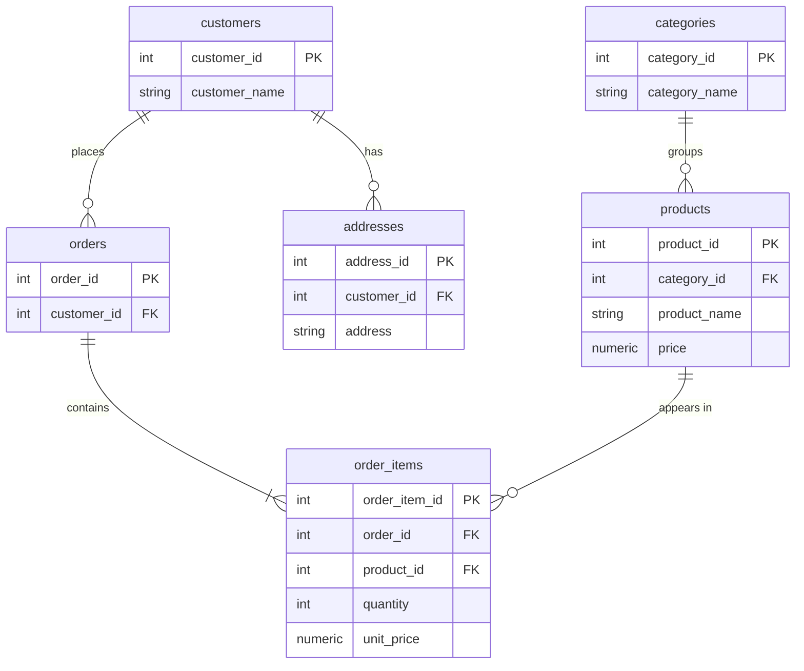

# Meeting 29 — ERD Praktik

## Ringkasan
Mempelajari cara membuat Entity Relationship Diagram (ERD) dari business requirement: mengidentifikasi entity, menentukan Primary Key dan Foreign Key, menentukan cardinality, menguraikan relasi many-to-many dengan associative entity, serta memahami kenapa `unit_price` disimpan di `OrderItem`. Pembahasan ditutup dengan perbedaan ERD relational (OLTP) dan Star Schema, serta workflow sembilan langkah dalam membuat ERD.

## 1. Konsep: ERD Itu Untuk Apa?

**ERD (Entity Relationship Diagram)** adalah representasi struktur database secara visual.

Tujuan utamanya bukan sekadar membuat gambar, melainkan menjawab pertanyaan berikut:

- Data apa yang perlu disimpan?
- Entity apa saja yang ada?
- Bagaimana entity saling berhubungan?
- Apa Primary Key-nya?
- Apa Foreign Key-nya?
- Bagaimana cardinality-nya?
- Apakah desainnya sudah menghindari redundancy?
- Apakah struktur tersebut sesuai business requirement?

Dalam pekerjaan Data Engineer, ERD berguna pada alur berikut:

```text
Business requirement
        ↓
Data Model
        ↓
Database
        ↓
ETL/ELT
        ↓
Analytics
```

## 2. Studi Kasus: E-Commerce

Anggap kita punya e-commerce sederhana dengan business requirement berikut:

- Customer dapat membuat banyak order.
- Satu order dapat memiliki banyak product.
- Satu product dapat muncul di banyak order.
- Product berada dalam satu category.
- Customer memiliki alamat yang dapat berubah.

Kita mulai dari requirement, **jangan langsung membuat tabel**.

### Identifikasi entity
Dari requirement tersebut kita menemukan:

```text
Customer
Order
OrderItem
Product
Category
Address
```

### Kenapa `OrderItem` diperlukan?
Karena hubungan `Order ↔ Product` adalah **many-to-many**.

```text
Order O001
├── Laptop
├── Mouse
└── Keyboard

Product Laptop
├── O001
├── O005
├── O009
└── ...
```

Relasi M:N tidak disimpan secara langsung. Kita memecahnya menggunakan **associative entity**:

```text
Order
   |
   | 1:N
   ↓
OrderItem
   ↑
   | N:1
Product
```

Ini konsep yang sangat penting.

## 3. Menentukan Primary Key

```text
Customer      →  customer_id    PK
Order         →  order_id       PK
OrderItem     →  order_item_id  PK
Product       →  product_id     PK
Category      →  category_id    PK
Address       →  address_id     PK
```

### Kenapa `OrderItem` punya ID sendiri?
Ada dua pendekatan:

| Pendekatan | Primary Key |
|------------|-------------|
| Surrogate key | `order_item_id` |
| Composite key | `(order_id, product_id)` |

Untuk sistem production, keduanya bisa valid, tergantung kebutuhan.

Misalnya satu product boleh muncul dua kali dalam satu order karena alasan tertentu. Dalam kasus itu, `(order_id, product_id)` tidak cukup unik, sehingga surrogate key lebih fleksibel.

## 4. Menentukan Foreign Key

Sekarang kita tentukan siapa yang "memiliki" relationship.

| Relasi | Cardinality | Foreign Key |
|--------|-------------|-------------|
| Customer → Order | 1 : N | `orders.customer_id` |
| Order → OrderItem | 1 : N | `order_items.order_id` |
| Product → OrderItem | 1 : N | `order_items.product_id` |
| Category → Product | 1 : N | `products.category_id` |
| Customer → Address | 1 : N | `addresses.customer_id` |

Aturannya: Foreign Key selalu berada di sisi **N** (tabel anak).

## 5. Bentuk ERD

Berikut ERD sederhana dalam bentuk diagram (mermaid, otomatis tampil sebagai gambar di GitHub):



Versi teks dari relasinya:

```text
Category 1 ──── N Product
Product  1 ──── N OrderItem
Order    1 ──── N OrderItem
Customer 1 ──── N Order
Customer 1 ──── N Address
```

## 6. Bagian Penting: `unit_price`

Perhatikan tabel `OrderItem`:

```text
OrderItem
----------
quantity
unit_price
```

**Kenapa `unit_price` perlu disimpan di `OrderItem`?**

Misalnya product Laptop saat ini berharga 10.000.000, lalu customer membeli:

```text
O001
Laptop
unit_price = 10.000.000
```

Kemudian harga product berubah menjadi 12.000.000. Jika kita hanya mengambil `Product.price`, order historis O001 akan terlihat dibeli seharga 12.000.000, padahal sebenarnya 10.000.000.

| Kolom | Merepresentasikan |
|-------|-------------------|
| `Product.price` | harga product **saat ini** (*current price*) |
| `OrderItem.unit_price` | harga ketika **transaksi terjadi** |

Ini contoh bagaimana business requirement memengaruhi data model.

## 7. ERD vs Data Warehouse

Ini juga penting bagi calon Data Engineer.

**ERD relational database** biasanya digunakan untuk OLTP:

```text
Customer
   ↓
Order
   ↓
OrderItem
   ↓
Product
   ↓
Category
```

Tujuannya:

- transaction processing,
- consistency,
- insert/update/delete,
- normalized data.

Sedangkan untuk analytics, kita bisa mengubahnya menjadi:

```text
             DimCustomer
                  │
                  │
DimProduct ─── FactSales ─── DimDate
                  │
                  │
             DimCategory
```

Ini sudah masuk Dimensional Modeling yang dibahas di Pertemuan 27.

**Jangan mencampur:** ERD relational model ≠ Star Schema. Keduanya punya tujuan yang berbeda.

## 8. Workflow Membuat ERD

Jangan mulai dari "mau bikin tabel apa?". Mulailah dari langkah-langkah berikut.

| Step | Langkah | Pertanyaan |
|------|---------|------------|
| 1 | Business requirement | Apa yang harus dilakukan sistem? |
| 2 | Identify entities | Data/object apa yang harus disimpan? |
| 3 | Identify attributes | Informasi apa yang dimiliki entity? |
| 4 | Determine PK | Bagaimana setiap record diidentifikasi secara unik? |
| 5 | Determine relationships | Siapa berhubungan dengan siapa? |
| 6 | Determine cardinality | 1:1, 1:N, atau M:N? |
| 7 | Resolve M:N | Gunakan associative entity |
| 8 | Check normalization | Cari redundancy, update anomaly, insert anomaly, delete anomaly |
| 9 | Check business rules | Apakah database benar-benar bisa merepresentasikan kebutuhan bisnis? |

Workflow ini jauh lebih penting daripada sekadar menghafal simbol ERD.

## Cheat Sheet

| Konsep | Ringkasan |
|--------|-----------|
| ERD | representasi visual struktur database |
| Entity | object/data yang disimpan (Customer, Order, Product, ...) |
| Cardinality | 1:1, 1:N, atau M:N |
| M:N | tidak disimpan langsung, diuraikan dengan associative entity |
| Associative entity | tabel perantara, misalnya `OrderItem` |
| Foreign Key | berada di sisi N (tabel anak) |
| `Product.price` | harga saat ini |
| `OrderItem.unit_price` | harga saat transaksi terjadi |
| ERD vs Star Schema | OLTP (normalized) vs analytics (dimensional) |
